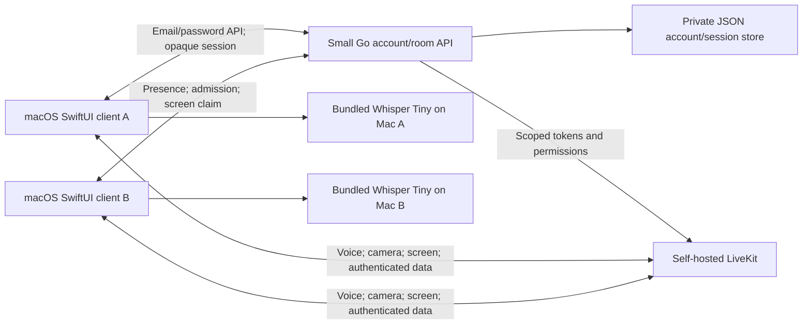

# Architecture and implementation references

## Native app

SwiftUI supplies a menu-bar roster and call controls, a dedicated Settings window, incoming-call prompt, permission checklist and a large screen viewer with camera tiles and an optional transcript panel. AppStore connects the account API to RTCService and WhisperTranscriber. SessionVault uses macOS Keychain. InteractiveScreenView renders LiveKit screen video through an AppKit view and maps input relative to the visible aspect-fit frame. Camera video uses LiveKit camera tracks, configurable 360p/720p/1080p at 30 fps, and renders only while explicitly enabled. Screen sharing uses Apple's system picker and the per-session `SCContentFilter`; display-region selection uses a local still preview and configures ScreenCaptureKit's source rectangle. Pairwise does not enumerate shareable windows or displays before the person explicitly picks a share source.

RTCService owns LiveKit connections, camera and screen tracks, microphone state and audio-renderer attachments. Camera authorization is requested only after the person turns video on; the selected camera quality is applied at the next camera start, and the camera stays off on call join. Remote participant identities are taken from SDK callbacks, not a sender field in untrusted JSON. Data messages are bounded and versioned. A host-generated control epoch and monotonic two-second lease invalidate old input; ordered reliable messages preserve key/button transitions. Drawing annotations use a separate rate-limited, session-scoped data topic and never invoke OS input; only the sharer can relay or disable them. The sharing Mac also broadcasts whether it will accept input and why not (no Accessibility access, control paused, or a window share), when a share starts and whenever that changes, and repeats it to any request it cannot grant; viewers show that reason instead of inferring control from the track name, and give up on an unanswered request after five seconds. The app releases known held input on supported revocation/teardown paths. It does not yet have a separate crash-surviving injection helper.

Screen capture starts only after the person selects a display in the macOS picker and the server grants a sharing claim. This avoids broad Screen Recording authorization while retaining explicit per-session user consent. The first preset is 1440p/30fps, 5 Mbps, no simulcast or application audio. These settings require actual text and scrolling evaluation; they are not a commercial-product quality benchmark.

Audio renderer callbacks copy normalized mono PCM, then enter a local inference pipeline only when transcription is opted in. Four bounded speaker buffers, an eight-job backlog limit, chunk limits, generation invalidation and process termination prevent runaway or cross-call work. Tiny inference uses two threads and a statically linked local helper. Text and temporary inference data have no backend endpoint.

## Account and media services

One Go API with a synchronized atomic JSON store is enough for this team's account and room metadata. It is not intended for multiple API replicas. Self-service signup can be restricted and configured to verify email through Resend. bcrypt verifies passwords; opaque random sessions authorize requests. Admin membership is checked server-side.

The API uses LiveKit's RoomService to create/recreate rooms with maxParticipants=4 and update publication permissions. Join grants camera, microphone, and data; a sharing claim adds screen video to one participant. Screen-share audio remains unavailable. Human admission reservations use heartbeat expiry; LiveKit supplies the final connected participant cap.

The development stack binds to localhost. Remote use requires API HTTPS, LiveKit WSS, reachable media ports and TURN/TLS. LiveKit/WebRTC transport encryption protects network transit; the server can access media because application-level E2EE is deferred in this user-approved scope.

## What we learned from Hopp

Reference: [Hopp repository](https://github.com/gethopp/hopp), pinned research commit `c35ef279071f96fb7db01eb024015127db681893`.

We inspected selected capture, room, interaction and clipboard paths for background knowledge. Hopp source was not copied into this implementation.

- Native capture and a compact desktop surface fit developer pairing well. Our client similarly keeps media/control inside a native process.
- Hopp separates some audio/screen connections. Our first version uses one RTC room per client to keep identity, admission and transport integration small.
- Pointer motion and cursor presence are coalesced on the lossy channel at up to 60 Hz; keys, clicks, and lease messages remain ordered and reliable, while scroll deltas are summed per 16 ms window. The viewer numbers all messages from one counter. The host tracks a separate pointer high-water mark so overtaken motion cannot block a click, and a stale pointer cannot move the host after a newer click. Clicks carry their own target coordinates.
- Adaptive screen quality samples the sender's selected WebRTC pair bandwidth and encoder limitation, plus recent receiver loss/RTT feedback. Three constrained samples step down one tier; eight healthy samples recover one tier. Capture size is capped at the user's selected preset (maximum 4K/30), and changes apply to the live ScreenCaptureKit stream without unpublishing it.
- Sampled input paths emphasized SDK participant identity. Our receiver also derives identity from the SDK and checks an explicit host lease/epoch before OS injection.
- The sampled clipboard assembler did not visibly establish all sender/size/deadline checks in that path. This is a reason to implement bounded, explicit clipboard operations later, not a claim about every Hopp release or its overall security.
- Earlier research did not establish media E2EE in the inspected Hopp connection setup. We state our own transport model plainly instead of claiming SFU exclusion.
- Quickstart deployment values and SDK branches are convenient for demos but need pinning and production configuration. Our secrets are generated locally; package versions and model checksums are recorded.

Hopp's advertised latency and feature descriptions are not measured results for PairDesk. Hopp was used only as a product and implementation reference; no Hopp code is included.

Direct calling uses authenticated invitations polled every two seconds. The caller joins a private LiveKit session while ringing; the recipient obtains admission after accepting. Invitations expire after 45 seconds, reserve one of four seats, and cannot be accepted by unrelated accounts. Active voice calls follow live participant membership rather than invitation expiry. Rooms remain transport details.

Version 0.3.0 treats explicit display sharing as consent to automatic control by authenticated call members. A FIFO single-driver arbiter grants a short lease; first input is buffered until a fresh grant, with bounded queued actions and ordered reliable transport. Ordinary host mouse movement and viewer focus loss release held inputs rather than disabling the share-session permission. The menu-bar Stop control action disables automatic grants until Resume or a new share. Client lifecycle observers operate without an open window, and the server ends hidden call sessions once fewer than two members remain.
